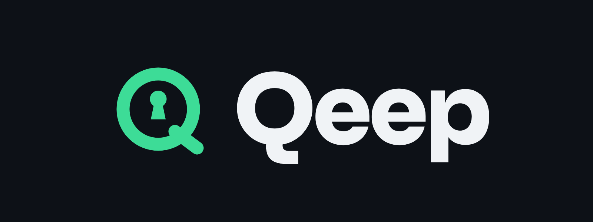

<p align="center">
  
</p>

<p align="center"><strong>Your Bitcoin dollars, kept safe for decades.</strong></p>

<p align="center">
  Qeep is a MUSD wallet on Mezo with a post-quantum Vault Key.<br/>
  Spend every day with a normal key. Move anything bigger only with a key quantum computers can't forge.
</p>

<p align="center">
  <a href="#live-deployment">Live app</a> ·
  <a href="docs/ARCHITECTURE.md">Architecture</a> ·
  <a href="docs/SECURITY.md">Security</a> ·
  <a href="docs/DEPLOYMENT.md">Deploy</a> ·
  <a href="packages/sdk/README.md">SDK</a>
</p>

---

## What Qeep is

Qeep is a self-custody wallet for MUSD, Mezo's Bitcoin-backed stablecoin. Qeep is built for people who hold MUSD as
savings and want it to stay safe for years, not just until the next breakthrough in quantum computing.

Qeep is a smart-contract account with two keys:

| Key | What it is | What it can do |
| --- | --- | --- |
| **Daily key** | A normal ECDSA key, encrypted with your password on your device | Send MUSD up to your daily limit |
| **Vault Key** | A 24-word phrase you keep offline. It signs with Winternitz one-time signatures (WOTS), a hash-based post-quantum scheme | Everything else: larger sends, changing the limit, recovering the wallet on a new device |

If someone steals your phone, or a future quantum computer breaks your Daily key, they can take at most one day's
limit. The rest stays behind the Vault Key.

Qeep is gasless for users. Qeep's relayer pays the BTC gas on Mezo. The relayer can't move funds: every action is
checked on-chain against your signature.

## The problem Qeep solves

Almost every crypto wallet today signs with ECDSA. A large enough quantum computer breaks ECDSA with Shor's algorithm,
and recent estimates of the hardware needed keep falling. Europol and EU supervisors have named wallets as the exposed
layer and asked for post-quantum key management.

MUSD is designed to be held: people borrow it against Bitcoin and keep it for long periods. Long-held savings are
exactly what a future quantum attacker would go after. Qeep protects that savings layer today, without waiting for
Mezo or Ethereum to change their signature schemes.

## How Qeep works

```
            ┌──────────────── your device ────────────────┐
            │  Daily key (encrypted)     Vault Key (typed  │
            │  signs small sends         in, then cleared) │
            └───────────────┬──────────────────┬──────────┘
                            │ signature        │ one-time WOTS signature
                            ▼                  ▼
                      ┌──────────── Qeep relayer ───────────┐
                      │ pays gas in BTC, can't move funds    │
                      └─────────────────┬───────────────────┘
                                        ▼
         ┌──────────────── QeepAccount on Mezo ────────────────┐
         │ spend()         ≤ daily limit   → ECDSA check        │
         │ vaultExecute()  anything else   → WOTS check on-chain│
         │                 then rotate to the next one-time key │
         └──────────────────────────┬──────────────────────────┘
                                    ▼
                                  MUSD
```

1. **Create.** Qeep makes a Daily key and a 24-word Vault Key in your browser. Only a hash of the first Vault Key goes
   on-chain. Qeep's factory deploys your account at a predictable address.
2. **Spend daily.** Sends under your limit are signed with the Daily key and relayed for free.
3. **Approve with the Vault Key.** Larger sends need your 24 words. Qeep signs locally with a one-time WOTS key; the
   account verifies it on-chain (about 250k gas) and moves to the next key.
4. **Restore.** On a new device, your 24 words find your account through the factory registry and make a new Daily key
   the owner. The old device stops working.

The full design is in [docs/ARCHITECTURE.md](docs/ARCHITECTURE.md).

## Why Qeep is good for Mezo

- **MUSD is the asset.** Qeep holds, sends and limits MUSD. Every user action moves or protects MUSD.
- **Lower friction (Track 2).** No seed-phrase wallet setup, no BTC needed for gas, installable on a phone as an app.
- **Built for long-term holders.** Mezo's pitch is living off your Bitcoin for years. Qeep makes holding MUSD for years
  safer.
- **Composable.** `vaultExecute` can call any contract, so the same Vault Key can approve Mezo Borrow, swaps and pools.
  The SDK lets other Mezo apps add a post-quantum approval step.

## Repository

```
qeep/
├── apps/web/          Next.js 16 app (PWA) and the gas relayer API route
├── packages/sdk/      @qeep/sdk: WOTS signing, Vault Key phrases, digests, ABIs
├── contracts/         Foundry project: QeepAccount, QeepAccountFactory, WOTS verifier, tests, deploy script
├── e2e/               End-to-end check: real contracts + real SDK on an in-memory EVM (no Foundry needed)
├── brand/             Logo (SVG + PNG), app icons, cover image, brand guide
└── docs/              Architecture, security, deployment, testing, submission material
```

## Quick start

Requirements: Node.js 20+ (22 recommended) and [Foundry](https://book.getfoundry.sh/getting-started/installation).

```bash
npm install          # installs the app and SDK
npm test             # SDK tests
npm run test:e2e     # contracts + SDK end to end, no Foundry needed

cd contracts && forge test -vv   # Solidity tests
```

Deploy step by step with [docs/DEPLOYMENT.md](docs/DEPLOYMENT.md), or hand
[AI_DEPLOY_PROMPT.md](AI_DEPLOY_PROMPT.md) to an AI coding agent.

Run the app locally after deploying the factory:

```bash
cp apps/web/.env.example apps/web/.env.local   # fill in factory address and relayer key
npm run dev                                    # http://localhost:3000
```

## Live deployment

| | |
| --- | --- |
| Network | Mezo testnet (chain ID 31611) |
| App | `[ADD VERCEL URL]` |
| QeepAccountFactory | `[ADD FACTORY ADDRESS]` |
| MUSD (testnet) | `0x118917a40FAF1CD7a13dB0Ef56C86De7973Ac503` |
| Relayer | `[ADD RELAYER ADDRESS]` |
| Explorer | https://explorer.test.mezo.org |

## Tech stack

Solidity 0.8.28 (EVM london) and Foundry · Next.js 16, React 19, TypeScript · viem · @scure/bip39 · Web Crypto
(PBKDF2 + AES-GCM) · Vercel · Mezo testnet

## What Qeep does not claim

Qeep is honest about its limits. Full details are in [docs/SECURITY.md](docs/SECURITY.md).

- Mezo itself still uses ECDSA for transactions. Qeep protects **your funds above the daily limit**, not the chain.
- The Daily key is still ECDSA, so up to one day's limit is exposed if it is broken.
- Qeep uses plain WOTS over keccak256. WOTS+ or a NIST scheme (SLH-DSA) is on the roadmap.
- Qeep is unaudited testnet software. Do not use it with real funds yet.

## Roadmap

| Milestone | Target | What ships |
| --- | --- | --- |
| 1. Mainnet beta | December 2026 | Audit of the account and WOTS verifier, WOTS+ upgrade, mainnet factory, relayer rate limits |
| 2. Mezo-native actions | Q1 2027 | Borrow MUSD against BTC and earn from inside Qeep, all approved by the Vault Key; Telegram bot for daily sends |
| 3. Qeep SDK for Mezo apps | Q2 2027 | Published `@qeep/sdk` so any Mezo app can add a post-quantum approval step; browser extension |

## Team

| Name | Role | Links |
| --- | --- | --- |
| `[YOUR NAME]` | `[ROLE]` | `[X / LinkedIn]` |

## License

MIT. See [LICENSE](LICENSE).
